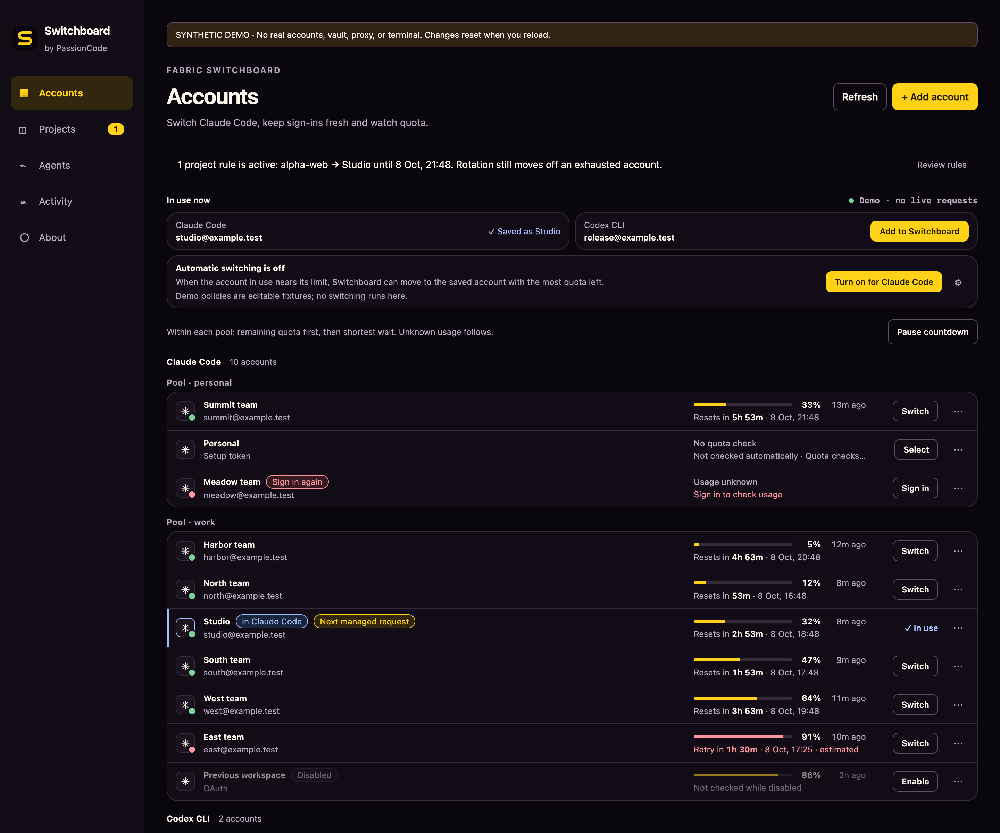

# Fabric Switchboard

[English](README.md) · **Русский**

Локальный менеджер аккаунтов и квот **Claude Code, Codex CLI и Kimi Code**.
Показывает, какой аккаунт сейчас используется и сколько квоты у него осталось, и открывает сессию
в нужном проекте. Приложение для macOS (Apple silicon и Intel), Windows (x64 и ARM) и Linux
(x64 и ARM), команда `switchboard` и MCP-сервер от [PassionCode.ai](https://passioncode.ai/).

**[Скачать для macOS](https://passioncode.ai/switchboard/download/macos)** ·
**[Скачать для Windows](https://passioncode.ai/switchboard/download/windows)** ·
**[Скачать для Linux](https://github.com/passioncode-ai/fabric-switchboard/releases/latest)** ·
[Установка](docs/INSTALL.md) · [Что нового](CHANGELOG.md) ·
[Сайт](https://passioncode.ai/switchboard/)



*Снимок версии 0.6.13: интерфейс на английском, демонстрационные аккаунты. В приложении также есть русский язык. [Данные о снимке](docs/runs/2026-10-08-release-0612/README.md#screenshots).*

## Что можно делать

| Задача | В Switchboard |
|---|---|
| Разделять рабочие и личные аккаунты | Группы проектов со своими аккаунтами (проект: репозиторий с его рабочими копиями и клонами; один проект может входить в несколько групп), правила папок и изолированные сессии |
| Знать, какой компании принадлежит аккаунт | «Организации»: компании с их почтовыми доменами; аккаунт относится к организации по вашему выбору, по команде у провайдера или по адресу; группа организации работает только на её аккаунтах; список можно получать из PassionCode.ai |
| Видеть, где работают аккаунты и куда уходят токены | «Статистика»: запросы и число токенов по данным провайдера по группам, проектам, аккаунтам, агентам и дням, с графиком по дням |
| Дать агентам на API-ключах свой ключ для группы | «API-ключи»: общий ключ OpenRouter для компьютера и свой ключ у группы; агент получает ключ группы, из папки которой его запустили |
| Видеть, когда понадобится другой аккаунт | Квоты по данным провайдера, обратный отсчёт до сброса и явные отметки, когда квота неизвестна или вход истёк |
| Выбирать следующий аккаунт | Переключение обычного Claude Code или выбор аккаунта для управляемых запросов; ответ, который уже идёт, остаётся на своём аккаунте |
| Работать с подписками Kimi Code | Официальный вход, тариф и квоты, запуск выбранного аккаунта в проекте |
| Выбирать и настраивать агентов | Какие агенты установлены, какие подхватывают работу и какой агент выбран по умолчанию; OpenCode и Hermes продолжают работу на ключе OpenRouter; модель выбирается из списка OpenRouter |
| Работать из терминала или агента | Команда `switchboard`, MCP-инструменты и запуск в текущей консоли через `launch --in-place` |

Сохранённые учётные данные защищает системное хранилище: Связка ключей macOS, Windows DPAPI или
Secret Service в Linux (GNOME Keyring, KWallet, KeePassXC). Автоматическое переключение
включается только по вашему выбору. Каждый аккаунт Kimi остаётся в своей папке входа:
Switchboard не копирует и не продлевает его вход. Подробности:
[аккаунты и переключение](docs/ACCOUNTS-AND-ROTATION.md), [поддержка агентов](docs/AGENT-SUPPORT.md).

## Текущая версия

**Текущий релиз:** [последний выпуск](https://github.com/passioncode-ai/fabric-switchboard/releases/latest)
(его номер указан на этой странице; установленные копии обновляются сами). Последние изменения:
0.6.81 больше не заставляет ждать, пока из хранилища медленно читается вход одного аккаунта;
0.6.80 показывает, на какую организацию работает сессия; 0.6.79 сохраняет вход, который
продлевался, когда вы закрывали Switchboard или он обновлялся. Заметки к каждой версии в
[CHANGELOG.md](CHANGELOG.md).

Универсальная сборка для macOS подписана Developer ID и прошла нотариальную проверку Apple.
Сборки для Windows (x64, arm64) собираются нативно и подписаны Authenticode (Azure Artifact
Signing, с меткой времени). Для Linux (x64, arm64) выпускаются пакет .deb, AppImage и архив с
одной командой `switchboard`. Начиная с 0.6.1 приложение обновляется само. Сборку и подписи
выполняет только защищённый [процесс выпуска](docs/DISTRIBUTION.md#how-a-release-happens).
Проверки с настоящими аккаунтами провайдеров отмечаются отдельно на
[доске](docs/evidence/backlog.md) (SB-01, SB-02, SB-15).

Открытый исходный код под **GNU AGPL-3.0**; доступна коммерческая лицензия.
[Условия](#лицензия).

## Документация

- [CLI и MCP](docs/CLI.md): команды, JSON, вход и запуск агентов.
- [Карта продукта](docs/PRODUCT.ru.md): возможности и ограничения.
- [Спецификация](docs/SPEC.md): поведение, безопасность и критерии приёмки.
- [Эксплуатация](docs/OPERATIONS.md): профили, восстановление и удаление.
- [Передача работы](docs/HANDOFF.md): проверки и следующая задача.

## Запуск из исходников

Для macOS нужны macOS 14+, Xcode Command Line Tools, Rust и Node.js. Для Windows нужны Rust
(MSVC), Visual Studio C++ Build Tools, Node.js и WebView2. Официальный `claude` или `codex` нужен
только для входа и запуска сессии, менеджер работает и без него. Статус проверки каждой платформы
указан в актуальном протоколе сборки.

```sh
npm ci
npm run app:dev
```

Создание локального приложения:

```sh
npm run app:build
open 'target/release/bundle/macos/Fabric Switchboard.app'
```

Эта команда сама по себе не подписывает приложение Developer ID и не проводит нотариальную
проверку, а сборка, подписанная на ноутбуке, считается отладочной. Релизы собирает, подписывает и
отправляет на нотариальную проверку только [процесс выпуска](docs/DISTRIBUTION.md) в GitHub
Actions. Бинарные файлы не хранятся в Git. Зависимости зафиксированы в `Cargo.lock` и
`package-lock.json`; побайтовая воспроизводимость сборки не заявляется.

Команда `switchboard` из исходников:

```sh
cargo build --release --locked -p switchboard-cli
./target/release/switchboard --help
./target/release/switchboard accounts list
./target/release/switchboard serve
```

Прокси и сессиями владеет `serve` или открытое приложение. Остальные команды сами обращаются к
этому владельцу. Без владельца изменения данных аккаунтов выполняются под монопольной блокировкой,
а вход и запуск требуют работающего владельца.

Чтобы посмотреть интерфейс на демонстрационных данных: `npm run dev`, затем
`http://127.0.0.1:1420/?demo=1`. Обычная веб-страница не подключается к хранилищу. В демо в
браузере нет настоящих аккаунтов, запуска CLI и сетевых запросов к провайдерам.

## Как пользоваться

1. **+ Добавить аккаунт**: официальный вход в отдельном профиле, API-ключ, setup-токен Claude или
   явно импортированный OAuth JSON. Аккаунт, на котором уже работает Claude Code или Codex,
   добавляется кнопкой **Добавить в Switchboard** в блоке «Сейчас используется». Switchboard читает
   текущий вход Claude Code и Codex, чтобы показать, какой сохранённый аккаунт сейчас используется,
   но без вас его не сохраняет и не переключает.
2. Новый аккаунт попадает в группу по умолчанию. Чтобы отделить рабочие аккаунты от личных,
   создайте группу (**Группы** → **+ Новая группа**), добавьте в неё папки проектов и её аккаунты:
   сессии из этих папок работают только на аккаунтах группы. Аккаунты разных провайдеров не
   взаимозаменяемы.
3. **Переключить**: обычный Claude Code на этом компьютере переходит на этот аккаунт.
   **Выбрать**: аккаунт для следующих управляемых запросов.
4. **Запустить…** (в меню «⋯» аккаунта): выберите папку проекта в системном окне, и в ней
   откроется CLI. Без галочки **Изолированная сессия** запуск идёт через локальный прокси как
   управляемая сессия: на выбранном аккаунте группы, приложение или `switchboard serve` должно
   оставаться открытым, у каждого провайдера и группы одна управляемая домашняя папка сессии.
   С галочкой сессия работает в собственной домашней папке аккаунта и соединяется с провайдером
   напрямую; последующий выбор аккаунта на неё не влияет.
5. **Папки** везде выбираются в системном окне выбора папки, а не вводятся текстом.
6. **Проверить использование**: квота проверяется в фоне (каждые 3 минуты для аккаунтов в работе
   или в группе с автоматическим переключением, каждые 10 минут для остальных), а эта команда
   проверяет сразу. По API-ключу квоту подписки достоверно узнать нельзя; неизвестная квота
   никогда не показывается как ноль.
7. **Автоматическое переключение** (**Включить для Claude Code** на странице «Аккаунты»): когда
   используемый аккаунт приближается к лимиту, Switchboard переходит на сохранённый аккаунт той же группы,
   у которого осталось больше всего квоты.
8. **Язык**: интерфейс на русском или английском, по языку системы; **О программе** → **Язык**
   меняет выбор ([SCN-041](docs/ux/scenarios.md#scn-041--use-switchboard-in-russian)).

Пользуйтесь Switchboard в соответствии с условиями использования Anthropic и OpenAI. Нарушение
условий провайдера может привести к блокировке аккаунта. Ответственность за то, как вы используете
свои аккаунты, несёте вы.

Постоянные учётные данные остаются в системном хранилище, но изолированная сессия записывает
рабочую копию токена доступа, нужную официальному CLI, в приватный файл (права 0600 на macOS,
доступ только для вашей учётной записи на Windows). Токен обновления туда не записывается; когда
срок токена доступа истечёт, войдите снова. Подробности, восстановление после сбоя и удаление:
[операционная инструкция](docs/OPERATIONS.md).

## Проверки и структура

```sh
./scripts/check.sh
# Явно запрошенный тест создаёт и удаляет только случайный синтетический элемент Связки ключей:
cargo test -p switchboard-core native_vault_roundtrip_uses_only_random_app_owned_item -- --ignored --exact
```

| Путь | Ответственность |
|---|---|
| `crates/switchboard-core` | аккаунты, Связка ключей и DPAPI, атомарная запись данных, снимок маршрутов |
| `crates/switchboard-proxy` | проверка доступа на loopback, запросы, потоки, использование |
| `crates/switchboard-runtime` | общий владелец, управляющий API, официальный вход и запуск CLI |
| `crates/switchboard-cli` | команда `switchboard`, stdin и JSON |
| `src-tauri` | нативное окно и связь с общим владельцем |
| `src` | интерфейс на TypeScript и явно обозначенное демо |
| `docs` | исследования, спецификация, сценарии, договорённости и доказательства проверок |

Полная проверка в GitHub Actions (сборка для macOS и нативные проверки для Windows) запускается
ночью; push и pull request её не запускают. Наличие процесса проверки не означает, что он прошёл.
Исходники других проектов изучены, но не включены как зависимости.

## Лицензия

Открытый исходный код под [GNU AGPL-3.0](LICENSE). Для использования, которое не выполняет
условия AGPL, доступна [коммерческая лицензия](COMMERCIAL-LICENSE.md):
[passioncode.ai/business](https://passioncode.ai/business/). v0.4.1-beta.1 стала первым релизом
под AGPL. Версии до v0.4.0-beta.1 включительно выпущены под PolyForm Noncommercial или Internal Use
(v0.4.0-beta.1) и под MIT (v0.3.1-beta.1 и раньше, коммиты до `7c36f4a` включительно) и сохраняют
свою лицензию. Лицензии сторонних компонентов в собранных программах перечислены в
[THIRD_PARTY_NOTICES.md](THIRD_PARTY_NOTICES.md). Вклад принимается по [CLA](CLA.md), см.
[CONTRIBUTING.md](CONTRIBUTING.md).
