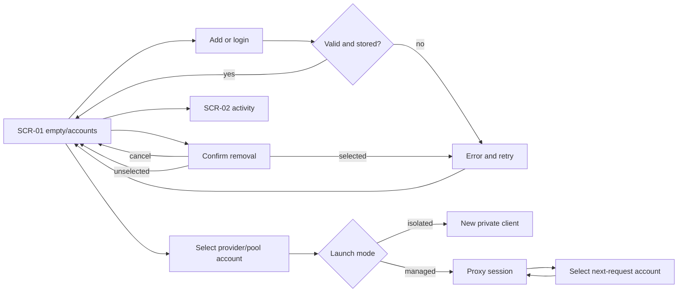
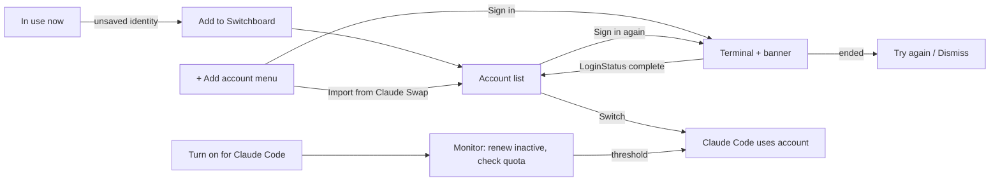
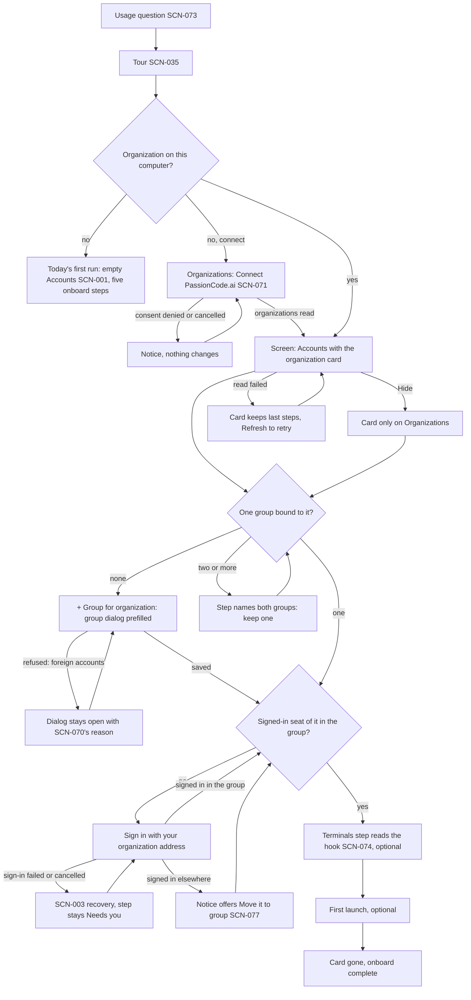
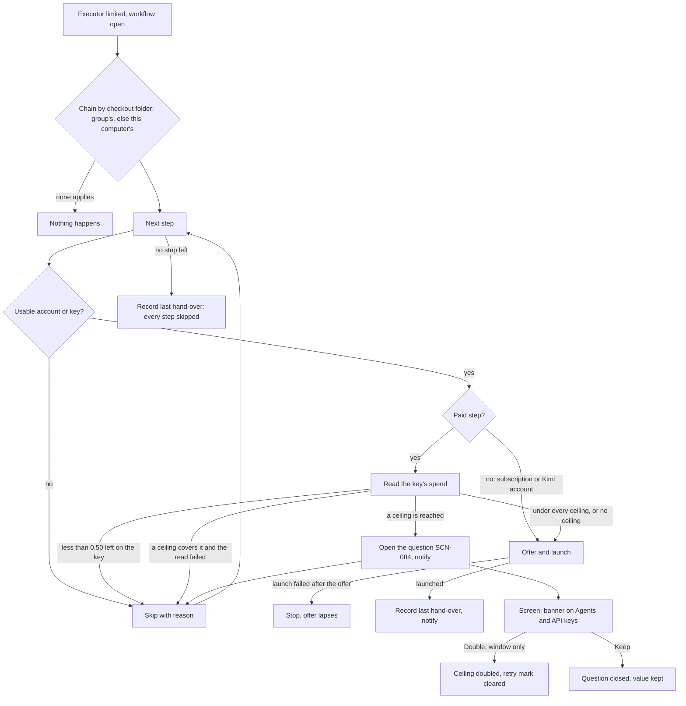

Contract: ux-contract v4
# Flows
## FLW-01 — Account workbench
Traces: ST-001, JTBD-01

## FLW-02 — Capture and rotate (0.3)
Traces: SCN-018..022; [implementation contract](../ACCOUNTS-AND-ROTATION.md).
Current CLI observation → capture existing / official login for another / import Claude Swap → identity upsert → current CLI badge and separate managed selection → quota windows/health → opt-in policy → eligibility + cooldown → managed route or locked native Claude activation → observe current again. No eligible account → hold with reason. Stop policy → persistent disabled state.

0.3.2 recovery edge (FLW-01, SCN-024): launch → account metadata/runtime → usable workbench; current CLI observation updates independently. Native read deadline → error → Retry. Add account → Import Claude Swap → existing import confirmation/result.

## FLW-03 — One-click accounts and prompt-free switching (0.5)
Traces: SCN-003, SCN-018…SCN-020, SCN-022, SCN-028, SCN-029; [PLAN-0.5](../PLAN-0.5.md).

## FLW-01 note (0.6.82)
A failed read never replaces a list already on screen (SCN-043): the list stays, a line above it offers *Retry*. Remove of a selected account goes through *Disable and remove* in the same dialog (SCN-010), not back to the list. Restore from About asks first (SCN-030).

## FLW-04: Set up an organization's work on a computer (0.7.0)
Traces: SB-202, SB-160, SCN-076, SCN-077, SCN-074, SCN-050, SCN-073, SCN-035
Entry points: the window after the usage question and the tour; `switchboard onboard` (the person's coding agent); the runbook `docs/ORGANIZATION.md`.
Success exit: `switchboard onboard --status --json` answers `"complete": true` and the card is gone.

## FLW-05: A hand-over at the switch, with the spend gate (0.7.0)
Traces: SB-73, SB-72, SB-71, SCN-040, SCN-082, SCN-083, SCN-084
Entry points: none (the background monitor finds a limited executor with an open workflow).
Success exit: a step is offered and its session opens; or every step is skipped and the reasons are on SCR-03.

Screens traversed: SCR-03 (populated, last hand-over, ceiling question banner); API keys (ceiling question banner, no SCR id yet).
